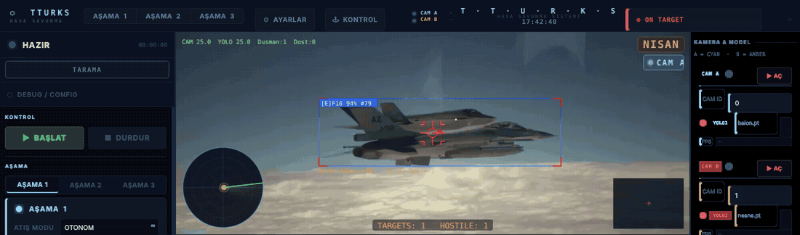
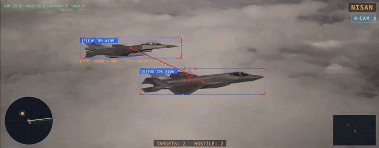
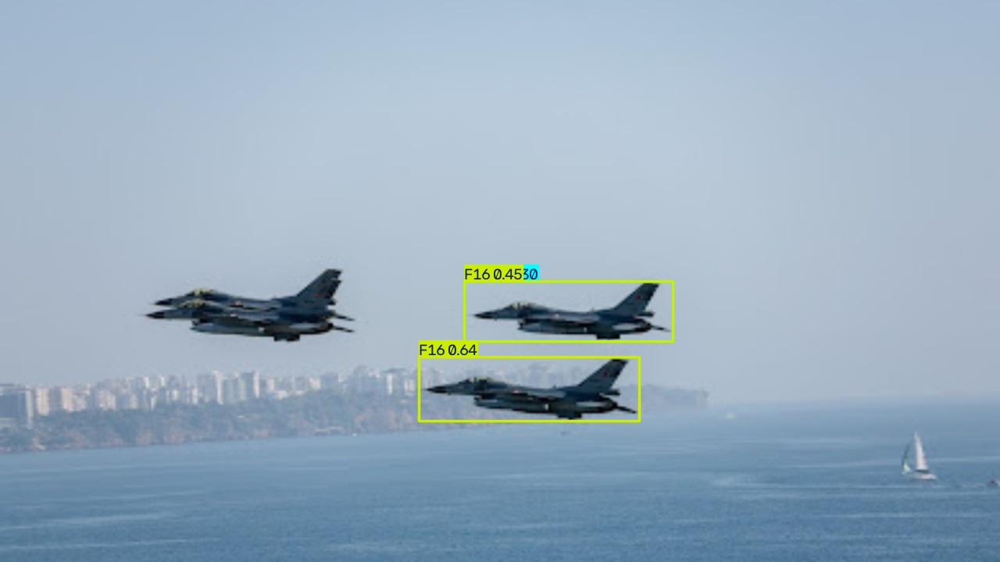
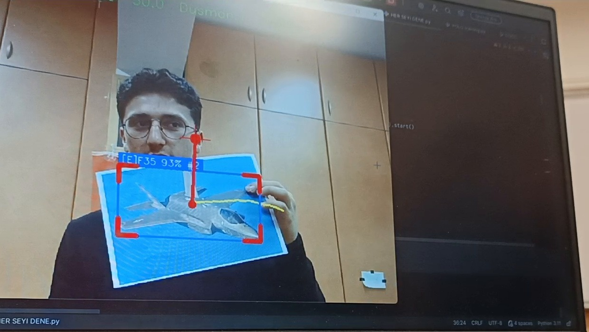
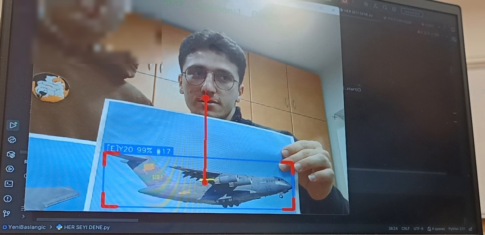
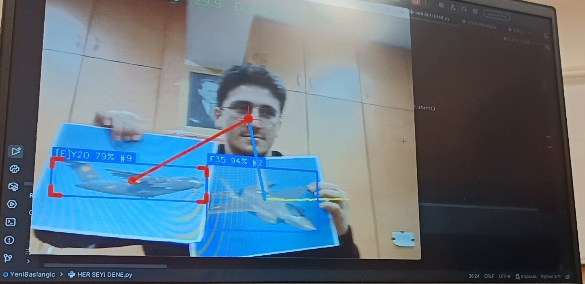
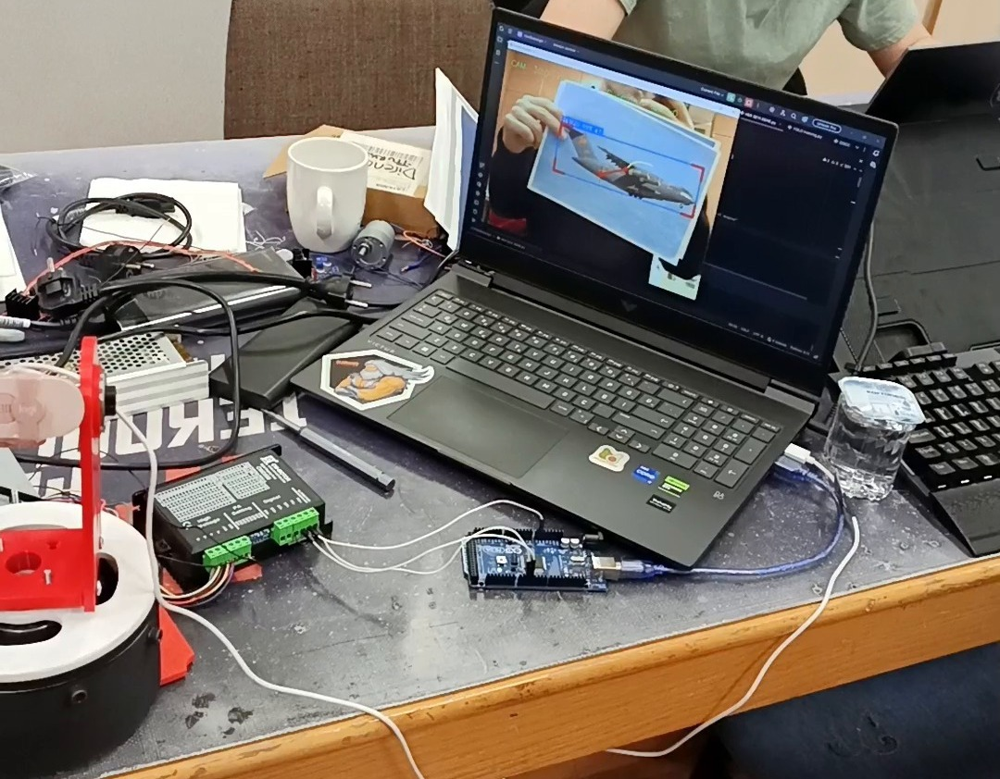
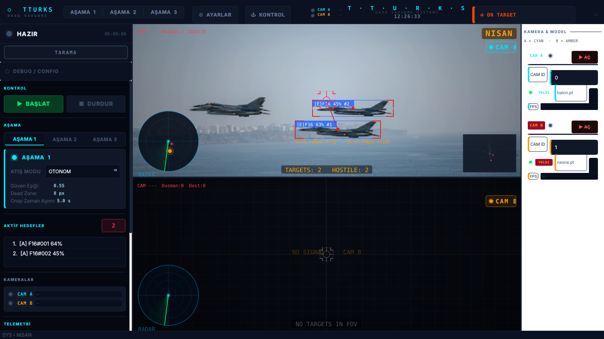
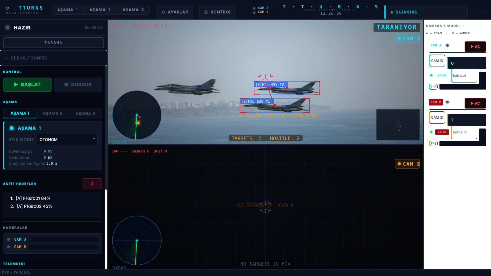

# KuraganKhan HSS

**[English](#english) · [Türkçe](#türkçe)**



<sub>The interface running my YOLOv8m model + BoT-SORT on F-16 / F-35 footage. Arayüz, F-16 / F-35 görüntüsü üzerinde kendi modelim ve BoT-SORT ile çalışırken. Footage: Dutch Ministry of Defence, <a href="https://commons.wikimedia.org/wiki/File:Dutch_F-35_and_USAF_F-16.webm">Wikimedia Commons</a>, CC BY-SA 4.0.</sub>

**▶ [Video: every correctly labeled moment, full interface / Video: doğru etiketlenen tüm anlar, tam arayüz](docs/hss_demo.mp4)**

---

## English

Air defense vision software I wrote for the **Teknofest Air Defense Systems (HSS)** competition with team **TTURKS**.
Two cameras look at the field, YOLO finds the targets, a tracker keeps their IDs, and the result is sent over serial to an STM32 that drives the pan/tilt gimbal and the laser.

> **Status: not finished.** We didn't make it past the report stage this season, so the project stopped before it was complete and it still has gaps:
> - The interface is the first version I built; it is not finished.
> - Live testing on the real turret was limited, so thresholds and gimbal gains are not tuned.
> - Stage 2 only uses camera A for now; the camera B path is not wired in yet.
> - LiDAR and stereo distance are written but disabled by default and not calibrated on hardware.
>
> Detection, tracking and the basic gimbal control loop work.

### What it does

The competition has three stages and each one runs in its own thread (`asama1/`, `asama2/`, `asama3/`). A small state machine (`sistem_fsm.py`) switches between them and pushes per-stage camera settings to the detection threads.

| Stage | Task | How |
|---|---|---|
| 1 | Hit stationary / moving balloons | YOLO detection, priority score (class + confidence + size), P-control to gimbal steps, fire when centered |
| 2 | Swarm, friend / foe | A target has to be confirmed over consecutive frames before it gets engaged, the gimbal follows the most confident enemy, friendly classes are drawn but never engaged |
| 3 | Engagement by color + shape | OpenCV HSV masks and contour analysis (circle / triangle / rectangle), PID aiming, spiral search when the target is lost, lock counter before firing |

Things that run in all stages:

- **Detection:** Ultralytics YOLO, one model per camera. `.pt`, `.onnx` and TensorRT `.engine` files all load (I used TensorRT on an RTX 4060).
- **Tracking:** BoT-SORT with a tuned config (`botsort_tturks.yaml`), ByteTrack as an alternative. If tracking fails once it falls back to plain detection instead of crashing.
- **Distance:** TF-Luna / RPLidar over serial, plus stereo triangulation from the two cameras. The two are fused when both are available. There is also a simulated LiDAR for testing without hardware.
- **Hardware:** STM32 over pyserial. Gimbal commands look like `!X120Y-40*`, fire / laser commands are plain text. Ports and formats live in `config.py`. This repo is only the Python side; the STM32 firmware is not included.
- **Manual / autonomous mode:** In manual mode the operator has to confirm each shot. Keyboard control (WASD, F to fire, Esc for emergency stop).
- **Emergency stop:** One global event; every detection thread stops inference and the gimbal gets a stop command.

### Aircraft model

| | |
|---|---|
| Architecture | YOLOv8m |
| Dataset | ~17K images, 78 aircraft classes |
| Epochs | 100 |
| mAP50 | 0.64 |
| mAP50-95 | 0.57 |

Weights are not in the repo (size + competition data). Put your own models in `models/`:

```
models/
  balon.pt   # camera A (stage 1)
  nesne.pt   # camera B
```

### Running

Python 3.10+, I developed and tested it on Windows.

```bash
python -m venv .venv
.venv\Scripts\activate
pip install -r requirements.txt
python main.py
```

For GPU, install the CUDA build of PyTorch first. Without an STM32 connected the program still opens; serial errors are only logged.
Settings changed from the UI are saved to `config_override.json` next to `main.py`.

### Project layout

```
main.py              threads, models and window setup
config.py            cameras, serial ports, gimbal, keys, thresholds
sistem_fsm.py        stage switching
motor.py, donanim.py serial / STM32
asama1/ asama2/ asama3/
utils/               camera + detection threads, tracker, LiDAR, stereo, drawing
ui/                  PyQt6 interface
```

---

## Türkçe

**Teknofest Hava Savunma Sistemleri (HSS)** yarışması için **TTURKS** takımında yazdığım görüntü işleme yazılımı.
İki kamera alanı izliyor, YOLO hedefleri buluyor, tracker ID'leri koruyor ve sonuç seri port üzerinden pan/tilt gimbal'ı ve lazeri süren STM32'ye gönderiliyor.

> **Durum: tamamlanmadı.** Bu sezon rapor aşamasını geçemedik, bu yüzden proje bitmeden durdu ve hâlâ eksikleri var:
> - Arayüz yaptığım ilk sürüm, tamamlanmadı.
> - Gerçek taret üzerinde canlı test sınırlı kaldı, eşikler ve gimbal kazançları ayarlanmadı.
> - 2. aşama şimdilik sadece A kamerasını kullanıyor, B kamerası henüz bağlanmadı.
> - LiDAR ve stereo mesafe kodu yazıldı ama varsayılan olarak kapalı ve donanımda kalibre edilmedi.
>
> Tespit, takip ve temel gimbal kontrol döngüsü çalışıyor.

### Ne yapıyor

Yarışma üç aşamadan oluşuyor ve her aşama kendi thread'inde çalışıyor (`asama1/`, `asama2/`, `asama3/`). Küçük bir durum makinesi (`sistem_fsm.py`) aşamalar arasında geçişi yapıyor ve her aşamanın kamera ayarlarını deteksiyon thread'lerine aktarıyor.

| Aşama | Görev | Nasıl |
|---|---|---|
| 1 | Sabit / hareketli balon imhası | YOLO tespiti, öncelik skoru (sınıf + güven + boyut), gimbal adımlarına P-kontrol, hedef merkezdeyken atış |
| 2 | Sürü, dost / düşman ayrımı | Hedef ardışık karelerde doğrulanmadan angajman yapılmıyor, gimbal en yüksek güvenli düşmanı takip ediyor, dost sınıflar çiziliyor ama asla hedef alınmıyor |
| 3 | Renk + şekil ile angajman | OpenCV HSV maskeleri ve kontur analizi (daire / üçgen / dikdörtgen), PID ile nişan, hedef kaybolunca spiral arama, atıştan önce kilit sayacı |

Tüm aşamalarda ortak olanlar:

- **Tespit:** Ultralytics YOLO, her kameraya ayrı model. `.pt`, `.onnx` ve TensorRT `.engine` dosyaları yüklenebiliyor (RTX 4060 üzerinde TensorRT kullandım).
- **Takip:** Ayarlanmış config ile BoT-SORT (`botsort_tturks.yaml`), alternatif olarak ByteTrack. Takip bir kez hata verirse program çökmek yerine düz tespite geçiyor.
- **Mesafe:** Seri port üzerinden TF-Luna / RPLidar, ayrıca iki kameradan stereo üçgenleme. İkisi de varsa birleştiriliyor. Donanımsız test için simüle LiDAR modu da var.
- **Donanım:** pyserial ile STM32. Gimbal komutları `!X120Y-40*` formatında, atış / lazer komutları düz metin. Portlar ve formatlar `config.py` içinde. Bu repo sadece Python tarafı; STM32 yazılımı dahil değil.
- **Manuel / otonom mod:** Manuel modda her atışı operatör onaylıyor. Klavye kontrolü (WASD, F atış, Esc acil durdur).
- **Acil durdur:** Tek bir global event; tüm deteksiyon thread'leri çıkarımı durduruyor ve gimbal'a dur komutu gidiyor.

### Uçak modeli

| | |
|---|---|
| Mimari | YOLOv8m |
| Veri seti | ~17 bin görsel, 78 uçak sınıfı |
| Epoch | 100 |
| mAP50 | 0.64 |
| mAP50-95 | 0.57 |

Model ağırlıkları repoda yok (boyut + yarışma verisi). Kendi modellerini `models/` klasörüne koy:

```
models/
  balon.pt   # kamera A (1. aşama)
  nesne.pt   # kamera B
```

### Çalıştırma

Python 3.10+, Windows üzerinde geliştirip test ettim.

```bash
python -m venv .venv
.venv\Scripts\activate
pip install -r requirements.txt
python main.py
```

GPU için önce PyTorch'un CUDA sürümünü kur. STM32 bağlı değilken de program açılıyor; seri port hataları sadece loglanıyor.
Arayüzden değiştirilen ayarlar `main.py` yanındaki `config_override.json` dosyasına kaydediliyor.

### Klasör yapısı

```
main.py              thread, model ve pencere kurulumu
config.py            kameralar, seri portlar, gimbal, tuşlar, eşikler
sistem_fsm.py        aşama geçişleri
motor.py, donanim.py seri port / STM32
asama1/ asama2/ asama3/
utils/               kamera + deteksiyon thread'leri, tracker, LiDAR, stereo, çizim
ui/                  PyQt6 arayüz
```

---

## Screenshots / Ekran Görüntüleri

F-16 and F-35 tracked at the same time / F-16 ve F-35 aynı anda takipte (0.5x, footage: Dutch Ministry of Defence, CC BY-SA 4.0):



Model on a test video / Test videosunda model (17K aircraft dataset, YOLOv8m):



Desk tests with printed aircraft photos and a webcam / Basılı uçak fotoğrafları ve webcam ile masa testleri:

| | |
|---|---|
|  |  |
|  |  |

Target lock / Nişan modu:



Scanning mode / Tarama modu:



---

Made for TTURKS, Teknofest 2026 HSS. Code by Emirhan Sırma (Kuragan).
TTURKS takımı için, Teknofest 2026 HSS. Kod: Emirhan Sırma (Kuragan).

**License / Lisans:** AGPL-3.0 (Ultralytics YOLO is AGPL-3.0 / Ultralytics YOLO AGPL-3.0 lisanslı).
`docs/demo.gif`, `docs/f16_f35.gif` and `docs/hss_demo.mp4` use CC BY-SA 4.0 footage and are shared under the same license / aynı lisansla paylaşılmıştır.
